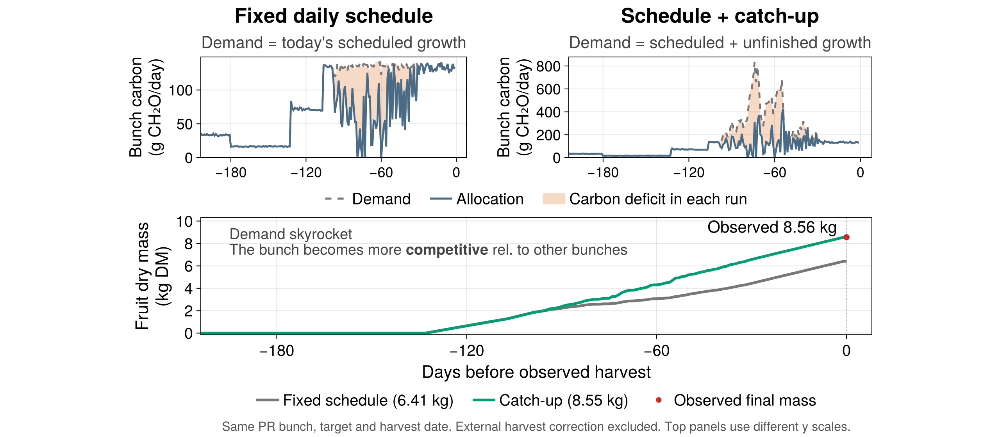
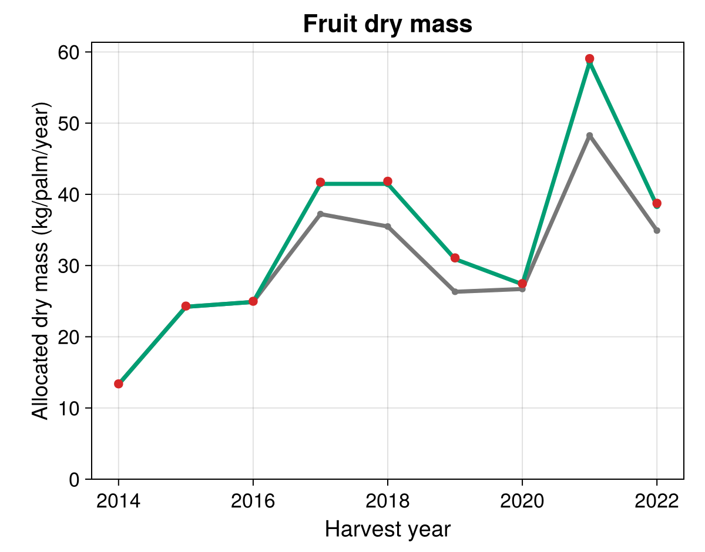
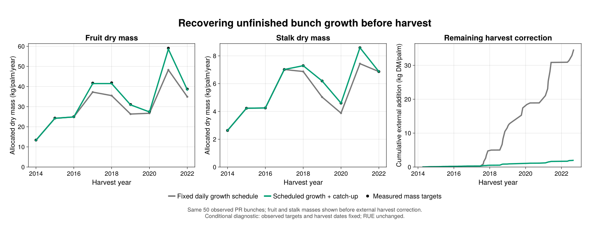
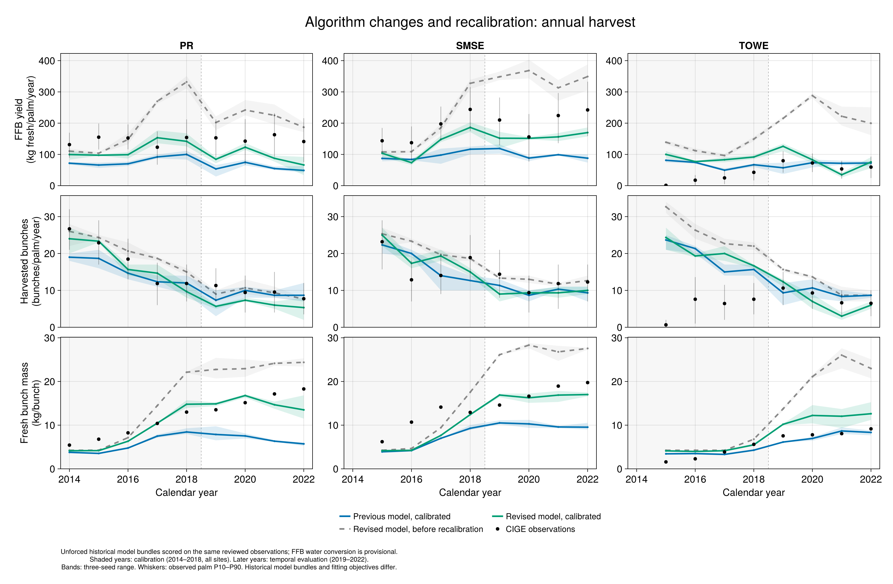
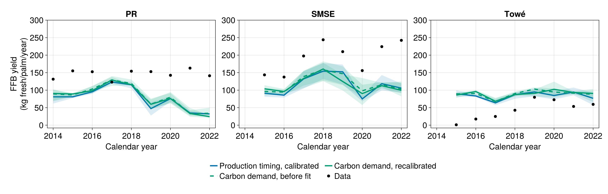

# Recover unfinished bunch growth before harvest

A daily growth schedule answers “what becomes due today?”. It does not necessarily
answer “what still needs to grow?”. The fixed female-demand model requests today's
scheduled increment and forgets any part that yesterday's carbon allocation could
not fund. We investigated whether that assumption could explain underfilled bunches
when observed organ histories and final sizes were already used to constrain the model.

## Use the alternative explicitly

```julia
using XPalm
parameters = XPalm.default_parameters()
parameters["carbon_demand"]["Female"]["catch_up"] = true
palm = XPalm.Palm(parameters=parameters)
# XPalm.xpalm(meteo; palm=palm, architecture=false)
```

`catch_up=false` is the default; older parameter files without the key retain the
fixed schedule. The package exposes `XPalm.Models.CatchUpFemaleCarbonDemandModel`
for custom compositions. It accepts native potential masses and previous actual
component biomass; it needs no observation database, imposed endpoints or external
biomass ledger. Both alternatives use the existing allocation and biomass models.

This is an **experimental upper-bound growth-recovery hypothesis**. Recovery has
no separately calibrated physiological rate limit. It should be evaluated and
recalibrated explicitly before adopting it as a predictive default.

## 1. First establish what an observation-conditioned run means

The retrospective CIGE pilot used one observed rank-17 anchor per palm and a fixed
numbering offset to connect field and simulated phytomers. That correspondence is
an assumption: other anchors do not establish exact anatomical identity. Eligible
leaf final areas, reproductive sex and survival, available flowering/harvest dates,
fruit counts, and fruit/stalk dry-mass endpoints constrain corresponding processes.
Missing or rejected targets retain model fallbacks. Using future measurements is
intentional here: it reduces degrees of freedom for a structural diagnosis, not
for a forecast.

For measured fruit mass and count, the dry mass per fruit is derived from their
ratio; oil/non-oil partition remains the model assumption. Native component
construction costs convert an assimilate request into potential dry-matter growth.
**An observed final mass is not inserted continuously as growing biomass.** Actual
growth still comes from the carbon allocated to that organ. Remaining signed
endpoint discrepancies at imposed harvest are traced in an external assimilation
ledger. The figures below exclude that final external correction.

A failure to reach the target therefore means allocation-funded growth fell short
of the endpoint under those assumptions. It can arise from insufficient source,
maintenance and competing sinks, an inadequate request, or timing. It does not
uniquely identify low RUE.

## 2. Why change the demand hypothesis?

The investigation first checked accounting, reserves, RUE, stalk scheduling and
tissue costs. Raising source supply helped, but could not by itself recover all
scheduled growth. At the combined reference used for the paired catch-up test,
RUE was 6.24 in **both** runs; leaf costs, stem maintenance, counts, final targets
and observed dates were held at their reference choices. The experiment changes
recovery behavior and also caps daily-step endpoint overshoot. It is not an
isolated biological test of a recovery-rate parameter.

### One observed bunch, two coupled runs



PR field phytomer 146, observed harvest 5 November 2018:

| Quantity | Fixed schedule | Schedule + catch-up |
|:--|--:|--:|
| Observed fruit dry mass target (kg) | 8.559 | 8.559 |
| Allocation-funded fruit dry mass (kg) | 6.406 | 8.550 |
| Days with carbon allocation deficit | 65 | 68 |
| Maximum whole-bunch demand (g CH₂O/day) | 141.680 | 837.057 |

Upper panels show **each run's own** whole-bunch demand and allocation, on different
y scales. Orange is a carbon deficit: request minus actual allocation. It is not
an externally identical prescribed drought. The lower panel includes fruit only;
whole-bunch carbon also funds the stalk. The red endpoint is observed, whereas
the intervening growth trajectories are simulated. This illustrative bunch was
selected after screening the cohorts for a large fixed-schedule deficit and at
least 15 later fully funded days; it is not a random representative sample.

The catch-up request can be larger than the fixed daily request during and after
a deficit. Under relative allocation, that makes the bunch a stronger competitor
for finite carbon, including against other bunches and vegetative organs. The
bunch can therefore receive more carbon even on a day when its larger request is
not fully met. Recovery is not restricted to a final stress-free interval.

This is **demand memory**, not a multiplier sensing past environmental stress.
It does not create carbon, raise the final potential, postpone harvest or guarantee
that the target will be reached under persistent source limitation.

## 3. The formalism and biomass accounting

For each component j (non-oil fruit, oil, stalk), let:

- S be unique scheduled new dry mass, B₀ initial actual dry mass;
- P be the current native final potential and Bprev previous actual dry mass;
- d be the baseline daily assimilate request, c its construction cost.

```math
S_t=\max\{S_{t-1},\min[\max(0,P_t-B_0),S_{t-1}+d_t/c]\},
```

```math
D_t=c\max\{0,\min(P_t,B_0+S_t)-B_{t-1}\}.
```

The schedule is accrued once and never erased by a temporary fall in potential.
The request is capped by the current potential; existing actual biomass is not
removed if a potential falls. Pending fruit-count sentinels do not become negative
mass targets. Harvest and abortion stop all further requests.

The ordinary female biomass model still distributes bunch allocation A across
components according to their requests:

```math
A_j=A\frac{D_j}{\sum_k D_k},\qquad \Delta B_j=\frac{A_j}{c_j}.
```

The construction cost is 1.44 g CH₂O-equivalent/gDM for stalk and non-oil tissue,
and 3.2 for oil in the default parameter set. Oil is already part of fruit mass;
it is not added twice. Demand/allocation/reserves use CH₂O-equivalent, while
structural stocks use dry matter. Previous actual component stocks are bound
explicitly with `PreviousTimeStep` to `FemaleBiomass`, avoiding a same-step cycle.
The residual ledger freezes on the first terminal day, before harvest clears
structural biomass; later terminal days cannot recreate a deficit from empty
standing stocks. New-schedule and repeated-request diagnostics are separate: summing daily retries
as new biological potential would double count the same unfinished growth.

Native scheduled growth follows thermal increments in component windows, with
later oil formation. It is piecewise linear in thermal progress, not a fitted
sigmoid. A daily demand curve is a rate, whereas biomass is funded accumulation.

## 4. From one organ to multiple calendar years





These are the **same 50 observed PR bunches**, grouped by observed harvest year
2014–2022 (nine calendar years). They are selected measured cohorts, not exhaustive
annual yield of that palm or a plantation. External endpoint corrections are
excluded from the growth curves.

| Diagnostic | Fixed schedule | Catch-up |
|:--|--:|--:|
| Remaining positive external addition, fruit + stalk (kg DM) | 34.691 | 1.989 |
| Fruit dry-mass RMSE before correction (kg/bunch) | 1.048 | 0.065 |
| Stalk dry-mass RMSE before correction (kg/bunch) | 0.156 | approximately 0.000 |

The paired reduction in remaining correction is 94.3%; it must not be confused
with the longer investigation's initial approximately 100.6 kg correction, which
was reduced by several earlier changes. Only the green trajectory nearly reaches
these imposed endpoints through allocation. That is evidence against the
fixed-schedule assumption **under the tested conditions**, not independent
prediction of those same observed endpoints.

Demand feedbacks slightly change canopy growth and later assimilation: total
2014–2022 gross assimilate supply was 7,942.2 versus 7,914.0 kg CH₂O. RUE is the
same; realized carbon supply is not imposed identical. Unique scheduled demand
changed only 0.0032% through the accompanying cap; no separate cap-only experiment
was performed. Daily physiological recovery rates remain unvalidated.

## 5. Recalibration and whole-model evaluation

### Historical three-curve comparison



This is the conference comparison: previous calibrated model (blue), revised
before recalibration (grey dashed), revised recalibrated (green). All are unforced
whole-model simulations. The previous model already includes study changes and
is **not** the released package with untouched defaults.

| Pooled FFB, 25 common site-years | Previous calibrated | Revised before recalibration | Revised calibrated |
|:--|--:|--:|--:|
| Modeling efficiency | −0.338 | −1.831 | 0.377 |
| Normalized bias (%) | −39.23 | 66.02 | −14.19 |
| nRMSE (%) | 60.78 | 88.40 | 41.46 |

Metrics score the three-seed mean, weighting each observed site-year equally;
normalization uses the pooled observed mean. Pooled efficiency includes
between-site differences. This is not an average of site-specific scores.

The revised historical bundle also changes earlier stalk demand, leaf costs,
FTSW/ET₀ coupling and reproductive random streams. Calibration objectives and
parameter scopes differ between historical fits. The improvement supports that
bundle and illustrates parameter compensation; it cannot establish a causal
catch-up-only improvement. Later Towé FFB RMSE worsens (15.88→26.69 kg fresh/palm/year),
and harvested-bunch-count RMSE worsens at all three sites.

### Countercheck: matched calibration protocol



The subsequent controlled sequence keeps a common nine-response objective,
14 coordinates and bounds, support, and a 72-configuration fitting budget.
C and E were independently fitted on 2014–2018 at all three sites, including
Towé; final comparisons use paired seeds 1–3. C is the calibrated reproductive
baseline; D adds native-target catch-up plus earlier stalk scheduling without
changing C's parameters; E recalibrates D.

| Pooled FFB RMSE (kg fresh/palm/year) | C | D | E |
|:--|--:|--:|--:|
| Calibration years 2014–2018, 13 site-years | 59.68 | 57.05 | 56.93 |
| Later years 2019–2022, 12 site-years | 84.63 | 83.07 | 87.34 |

This controlled result improves early fitting but **does not show improved later
yield prediction after recalibration**. Later years were already inspected during
model development; they are temporal evaluation, not untouched validation. The
controlled comparison and the older historical bundle must not be conflated.

FFB uses provisional fruit/stalk water fractions 0.2358/0.667 to convert native
dry outputs to fresh mass; this operator needs local validation. Observation
census completeness supports annual harvest totals, while component dissections
are a selected subset. Three-seed bands are descriptive stochastic min–max
ranges, not confidence intervals or population uncertainty.

## 6. What this package change does and does not adopt

The package port adds only optional native-target catch-up and its diagnostics.
It does not import the retrospective forcing machinery, observed endpoints,
external assimilation ledger, earlier-stalk schedule, tissue-cost changes, new
reproductive clock, calibration values, or whole-model bundles behind the figures.
The first stacked PR supplies separate lifecycle and rooted-recharge corrections.

The historical figures document how the hypothesis was reached; they are not
reruns of this port or proof that this option alone reproduces every panel.
Focused native-kernel, carbon-accounting, competition and compiled-lag tests
validate implementation. Independent organ growth trajectories, realistic maximum
recovery rates, late reproductive survival at Towé, and balanced recalibration
remain necessary scientific investigations.

## Provenance and reproduction

The adjacent assets contain the exact selected figures, plotted aggregate tables,
checksums and original plotting sources. Raw experiment databases are not bundled.
The `XPalm_calibration_new` analysis project records the numbered historical
steps: 84–86 (conditional sensitivity/results/figures), 96 and 99 (historical
comparison and pooled metrics), and 101–104 (controlled checks, fresh calibration,
figures and verified reporting completion). Access to its frozen input data and
recorded environments is required to rerun those studies. The bundled `assets/catchup/sources/render_public_figures.jl` can redraw the
organ and annual-fruit panels from the public compact tables alone; its Kaimon
drawing replay passed. Rendering from a saved table is distinct from rerunning
or recalibrating the model.
