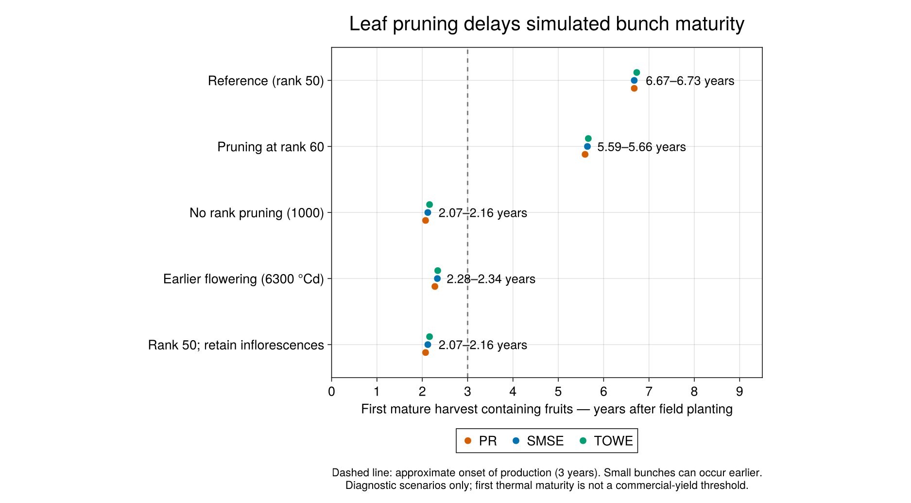

# Why leaf pruning must not harvest an immature bunch

The CIGE evaluation exposed very late simulated fruit production. Before fitting
physiological parameters, we checked which events were actually being counted as
harvests. Removing a leaf at rank 50 was also marking its phytomer and reproductive
organ `:harvested`. A little stalk biomass could consequently appear as harvested
yield before flowering, while the immature organ could never complete development.
This coupling was an intentional historical management policy, rather than a new
migration regression. Separating the two events changes that policy for the
physiological model and prevents its output being mistaken for mature harvest.

## Correct the event before calibrating its consequences

This change separates three events:

1. **Leaf pruning:** remove leaf area, structural leaf component masses and leaf
   reserves using the existing leaf-pruning policy. It no longer terminates the
   associated reproductive organ or changes the phytomer's reproductive state.
2. **Abortion:** a decision made by the abortion model remains terminal. The
   subsequent phenology calculation cannot overwrite it with flowering or fruit
   development on the same timestep.
3. **Mature harvest:** the existing reproductive thermal threshold still declares
   maturity. The bunch-harvest model emits daily mass and fruit-count pulses only
   on the harvest day, then resets those pulses. Aborted biomass enters litter.

Harvest-triggered leaf pruning is retained. This patch does not introduce natural
leaf senescence, an age-dependent reproductive clock, earlier flowering parameters,
or an explicit management operation for removing immature bunches. If a management
scenario removes an immature bunch, that event needs its own explicit policy;
leaf pruning alone is no longer treated as proof of a mature harvest.

## Restore rainfall recharge of the rooted soil view

The BP water model tracks bulk and rooted-accessible water as overlapping views
of the same soil. Rainfall was first consumed while updating the bulk view, then
the already reduced remainder was used to update the rooted view. The rooted
view consequently missed recharge even while the bulk soil received rainfall.
Resetting its infiltration calculation to effective rainfall corrects that
bookkeeping. It does not add rain twice to an independent inventory: bulk and
rooted water must not be summed as two disjoint stores.

This is a numerical correction, not a fitted change of drought sensitivity,
root-depth parameters, soil capacity, or evapotranspiration. Focused wet/dry and
shallow-root checks accompany the correction. It can materially change water
stress and therefore invalidate parameter compensation in previous calibrations.

An existing limit remains for roots shallower than the top-layer boundary `Z1`:
the native bulk and rooted compartments partition evaporative and transpirable
capacity differently. Under prolonged extraction, the bulk transpirable pool
can be exhausted before the rooted pool, invalidating their shared extraction
balance. This patch corrects rainfall routing only; it does not repair that
shallow-root capacity/extraction model. Rain-only recharge is checked at shallow
and deeper roots, while quantitative dry-down closure is checked at roots
reaching or exceeding `Z1`, matching the archived audit's stated scope.

## How we identified the delay

In the archived 1 October 2026 diagnostic, the reference used the same nursery
forcing, weather, random seeds and standard physiological parameters across the
five scenarios. The decisive comparison retained rank-50 leaf pruning but allowed
inflorescences to continue developing. The first thermal-threshold harvest
containing fruits advanced as follows:

| Site | Reference | Rank 50, inflorescences retained |
|:--|--:|--:|
| PR, Nigeria | 6.67 years | 2.07 years |
| SMSE, Indonesia | 6.67 years | 2.12 years |
| TOWE, Benin | 6.73 years | 2.16 years |

Ages are **years after field planting**, with 548 nursery days before planting.
Nursery irrigation was a prescribed scenario, not a measured CIGE treatment.
The first small bunches were about 1.73 kg dry mass. A first fruit-bearing thermal
harvest can precede commercially significant production around three years.
The beginning of CIGE monitoring does not establish the true first harvest date.

The figure is an archived diagnostic of the mechanism, **not a newly fitted or
rerun prediction from this branch**. The changed rank-60, no-pruning and flowering
scenarios provide context and are not adopted by this patch. The exact plotted
summary, checks and SHA-256 provenance are saved beside the figure.
The historical contrast predates the abortion and rooted-recharge corrections
in this branch, so its exact dates are not asserted as the output of this full PR.

## Scope of the fix and other historical changes

The original investigation later tested leaf senescence, reproductive development
clocks, fruit-number and size responses, and carbon costs. Those are distinct
changes. They are not silently included here, and results from those larger model
bundles must not be attributed to this fix set alone. The older emitted-phytomer object-identity correction
was already upstream; this is not a second implementation of that fix.

## Reproduction and review

The historical analysis used `XPalm_calibration_new/1-code/10_reproduction_audit.jl`
and `11_reproduction_results.jl`, with frozen output family
`2-results/reproduction_audit_20261001`. The original diagnostic used XPalm 0.7.0
and PlantSimEngine 0.15.0 in its recorded environment. Raw CIGE observations are
not bundled in this package.

The package regression tests in `test/test-reproductive-lifecycle.jl` exercise
actual leaf-pruning stock removal, preservation of immature female development
in a compiled palm, abortion precedence, and one-day harvest pulses. They test
implementation behavior, not field validation. Published v0.7.0 numerical fixtures
remain unchanged; these intentional lifecycle corrections can change their
trajectories and require a separately reviewed future numerical reference.

`test/test-rooted-recharge.jl` checks rainfall routing, overflow and dry-day
bookkeeping in both overlapping soil views, with Float32 and Float64 statuses,
and compiles a soil scenario using the native root-growth hard call. Its
dry-down extraction checks have the `root_depth >= Z1` domain described above;
they do not establish a closed shallow-root extraction model or validate field
soil parameters.
